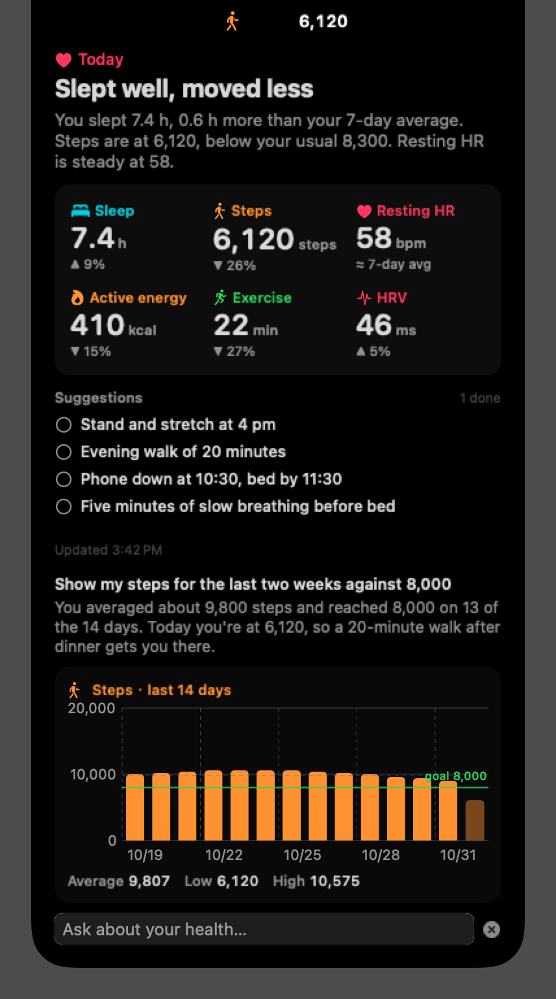
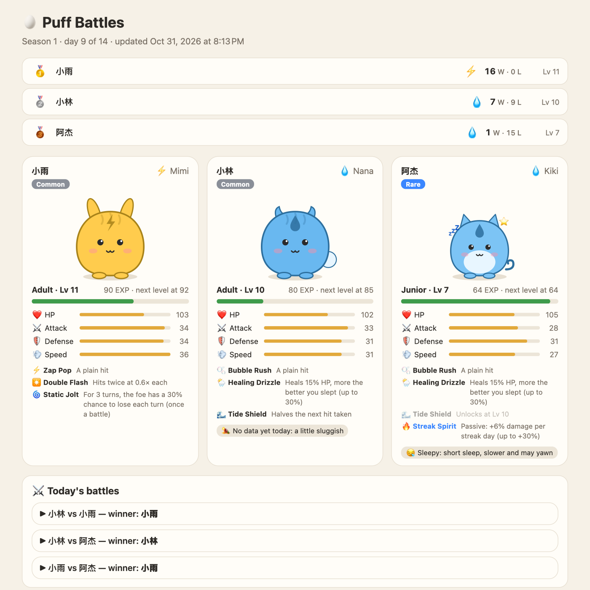
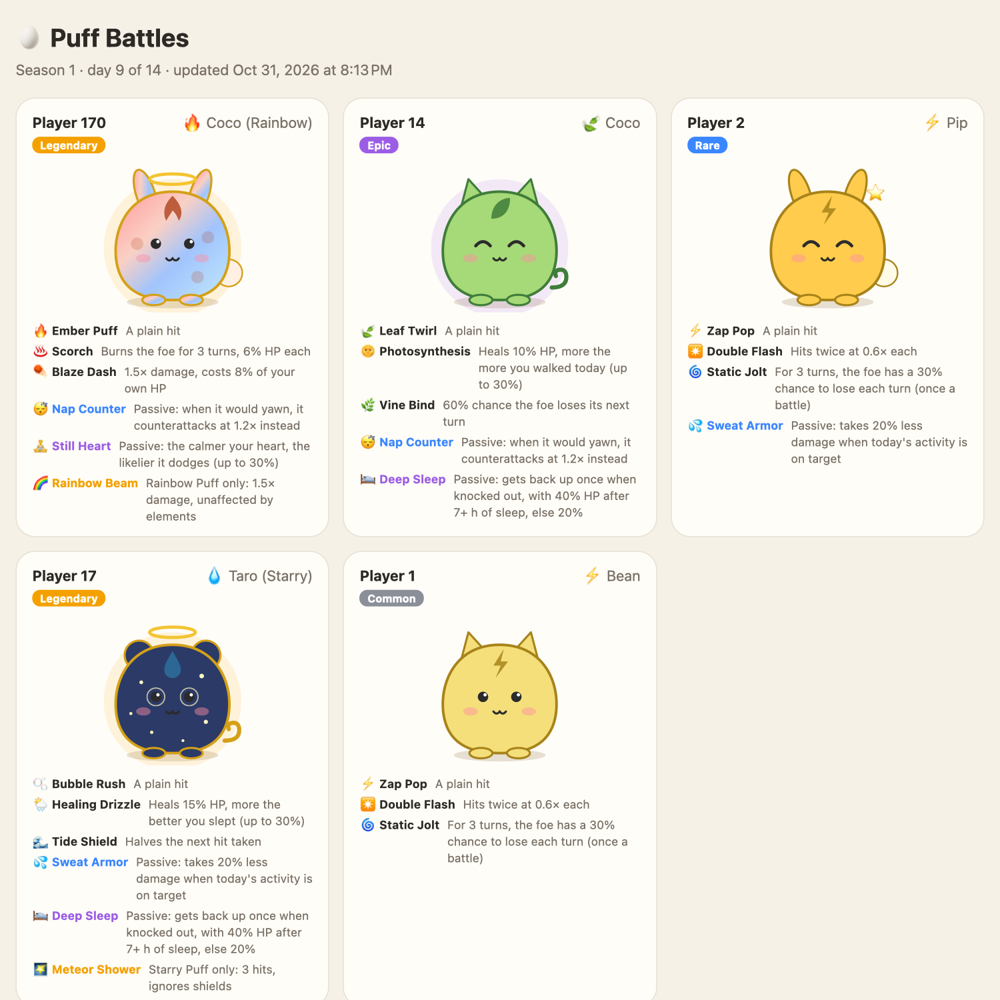
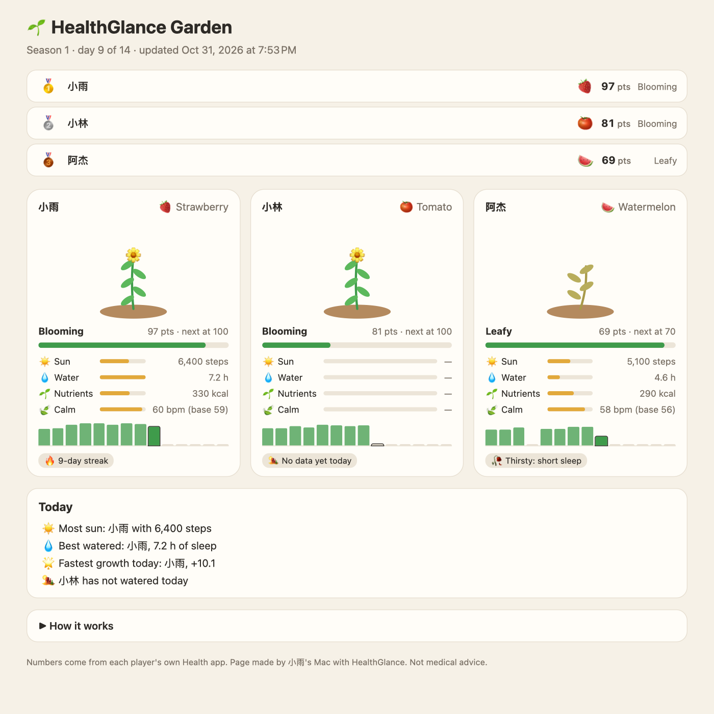

# HealthGlance

English | [中文](README.zh-CN.md)

Your iPhone Health data on your Mac desktop, summarised by AI every day: how you slept, how much you moved, how today compares with your last 7 days, and a checklist of what to do next.

<p>
  
  
</p>

*The screenshots use made-up sample data.*

## Introduction

### Features

- **A daily AI summary.** A specific headline, two or three sentences and your key numbers: sleep, steps, resting heart rate, active energy, and more when the shortcut exports them. Each number is compared with your own 7-day average. MiniMax writes it in English or Chinese; switch with **Language** in the menu.
- **Suggestions you tick off.** Four to six concrete things to do, each with a time or an amount, such as "Walk 15 minutes after lunch, ~1,500 steps". Tick one in the menu bar, on the desktop card or in the Dynamic Island and it fades away. When the summary is rewritten later in the day, finished items are not suggested again.
- **Questions about your data.** Type a question such as "How many more steps to reach 8,000?" and get a short answer based on your recent days, monthly averages, today's summary and the suggestions. Ask for advice or a plan ("Plan a better night's sleep"), and its steps join your suggestions. Each question stands on its own.
- **Charts in answers.** Ask to see something ("Show my steps for the last two weeks against 8,000", "How has my sleep changed this year?") and the answer comes with a chart the AI picks: daily bars or a trend line over a week to two years, with the average and a goal line.
- **History from the iPhone alone.** Each time the shortcut runs it sends the last 30 days, one line per day, so the Mac builds up a history of up to two years with nothing else to set up.
- **Three ways to show it on the desktop:**
  - a macOS **widget** in small, medium or large;
  - a **card** pinned to the desktop, which you can drag anywhere;
  - a **Dynamic Island**: hidden until you point at the top centre of the screen you are using. Then an icon and today's steps appear around the notch, or as a notch-shaped pill on screens without one. Click to open the card and the question box; click outside or press Esc to close it.
- **Always up to date.** The iPhone shortcut runs whenever you open an app you choose. The Mac checks iCloud once a minute and rewrites the summary when the numbers change, automatically at most every 30 minutes.
- **Friends and family.** Everyone who shares a `HealthGlance` folder in iCloud Drive gets their own card and 7-day history. Choose whose card is shown in the menu.
- **Games with friends.** Shared numbers become a game page that everyone opens from the folder. In **Puff Battles**, eggs hatch into random pets with rarities and skills, and the pets battle every day. In **Garden**, each player grows a plant. Invite players with a link, and start over at any time with **New game**.
- **Careful with your data.** Health data stays in your iCloud Drive and on your Mac. Only the numbers go to MiniMax, for the summary and your questions; the games never send them. Impossible values, such as a typo or an edited file, are ignored. The API key stays in a local file.

<p>
  
</p>

### How it works

macOS has no Health app, so a Mac cannot read Health data directly. An iPhone shortcut exports the numbers to iCloud Drive instead. A small menu-bar app on the Mac reads them, asks the MiniMax API for a summary, and shows the result on the desktop.

```
iPhone shortcut ──writes──▶ iCloud Drive/Shortcuts/HealthWidget/health.txt
                            (or the shared iCloud Drive/HealthGlance folder)
                                      │
Mac menu-bar app ◀──reads─────────────┘ ──calls──▶ MiniMax (OpenAI-compatible API)
        │ writes ~/Library/Application Support/HealthWidget/summary.json
        ▼
Widget (small / medium / large), a card pinned to the desktop, or a Dynamic Island
```

## Installation

### Requirements

- A Mac with Apple Silicon, running macOS 14 Sonoma or later.
- Xcode Command Line Tools. Install them with `xcode-select --install`. The full Xcode is not needed.
- An iPhone with Health data. An Apple Watch is optional, but some metrics need one.
- A MiniMax API key from [platform.minimaxi.com](https://platform.minimaxi.com) (China) or [platform.minimax.io](https://platform.minimax.io) (international).

### 1. Install the Mac app

```bash
git clone git@github.com:AlbertHX86/health-glance.git
cd health-glance
./build.sh install    # builds, signs locally, copies to ~/Applications and launches
```

1. Click the heart icon in the menu bar, paste your MiniMax API key and click **Save**.
2. Choose how to show it with **On the desktop** in **Settings**: **Card**, **Dynamic Island** or **Off**.
3. For the system widget, right-click an empty part of the desktop, choose **Edit Widgets**, search for **HealthGlance** and drag it onto the desktop. It comes in small, medium and large. If it is not in the list, use the card or the Dynamic Island instead.
4. To start the app at login, turn on **Launch at login**.

### 2. Set up the iPhone shortcut (once)

You can let the iPhone build the shortcut from a description, or build it by hand. Either way, finish with Steps 4 and 5.

#### Quick way: describe it to your iPhone

On iOS 27 with Apple Intelligence, the Shortcuts app can build a shortcut from a plain-language description. Tap **+** in the Shortcuts app and paste the text below:

```text
Create a shortcut named "Health Export" that does these steps in order:
1. Find Health Samples where Type is Steps and Start Date is in the last 30 days, grouped by Day, with Fill Missing off.
2. Repeat with each item from step 1: format its Start Date with the custom format yyyy-MM-dd, and make a Text of the formatted date, " steps: " and its Value.
3. Find Health Samples where Type is Active Energy and Start Date is in the last 30 days, grouped by Day, with Fill Missing off.
4. Repeat with each item from step 3: format its Start Date as yyyy-MM-dd, and make a Text of the formatted date, " active energy: " and its Value.
5. Find Health Samples where Type is Resting Heart Rate and Start Date is in the last 30 days, grouped by Day.
6. Repeat with each item from step 5: format its Start Date as yyyy-MM-dd, and make a Text of the formatted date, " resting heart rate: " and its Value.
7. Find Health Samples where Type is Sleep Analysis, End Date is in the last 30 days, Value is not Awake and Value is not In Bed, with no limit.
8. Repeat with each item from step 7: format its End Date with the custom format yyyy-MM-dd HH:mm, and make a Text of the formatted date, " sleep (", its Source, "): " and its Duration.
9. Combine the Repeat Results of steps 2, 4, 6 and 8 into one text, one item per line.
10. Save File: save the text to iCloud Drive in the Shortcuts folder, subpath HealthWidget/health.txt. Do not ask where to save. Overwrite the file if it exists.
```

The generated shortcut is not always right, so before saving, compare it with Steps 1–3 below. Check **Group By** Day and the date formats most carefully. If your iPhone is set to Chinese, use the Chinese description in [README.zh-CN.md](README.zh-CN.md) instead. Then continue with Step 4.

#### By hand

**Step 1: Create the shortcut and add the daily totals.** In the Shortcuts app, create a shortcut named `Health Export`. For steps, active energy and resting heart rate, add these two actions each:

1. **Find Health Samples**: Type is the metric, Start Date is in the last 30 days, **Group By** Day, **Fill Missing** off. (Group By appears once a type is chosen.)
2. **Repeat with Each** over its result. Inside, add **Format Date** on **Repeat Item › Start Date** with the custom format `yyyy-MM-dd`, then a **Text**: `[Formatted Date] steps: [Repeat Item › Value]`. Write `active energy` or `resting heart rate` for the other two.

**Step 2: Add the stretches of sleep.** Add **Find Health Samples**: Type is Sleep Analysis, End Date is in the last 30 days, Value is not Awake, Value is not In Bed, no limit. Add **Repeat with Each** over it; inside, **Format Date** on **Repeat Item › End Date** with `yyyy-MM-dd HH:mm`, then a **Text**: `[Formatted Date] sleep ([Repeat Item › Source]): [Repeat Item › Duration]`.

**Step 3: Combine and save.** Add a **Text** with the four **Repeat Results**, one under another. Add **Save File**: turn off **Ask Where to Save**, set the subpath to `HealthWidget/health.txt` and turn on **Overwrite If File Exists**.

The file then has one line per day and metric:

```
2026-10-30 steps: 10402
2026-10-31 steps: 2188
2026-10-31 resting heart rate: 61
2026-10-31 06:42 sleep (Apple Watch): 1800
```

The newest day feeds today's summary; the earlier days fill in your history, which the Mac keeps for two years as the days add up. Each run sends the last 30 days again, so a day the shortcut missed is filled in later. For a longer start, change 30 to 365 for one run; sleep takes a little longer to collect then. Line names can be English or Chinese, and sleep lengths can be seconds or `30 min`. When an iPhone and an Apple Watch both recorded a night, the larger total counts; a night belongs to the day you wake up.

#### Finish (both ways)

**Step 4: Run it once by hand.** The first time, the iPhone asks for permission to read each Health data type; allow them all. An automation cannot show these prompts, which is why the first run has to be manual.

**Step 5: Run it automatically.** In **Automation**, tap **+**, choose **App**, pick an app you open every morning, choose **Is Opened** and **Run Immediately**, then select `Health Export`.

An app trigger is used instead of a time of day because a locked iPhone cannot read Health data, so a timed run often fails.

Action names can differ slightly between iOS versions. If a filter is missing, skip it.

## Someone else's data

The Mac app can show more than one person. Each person has their own file, `health-<name>.txt`, for example `health-Mom.txt`, and gets a separate summary with a separate 7-day history. Choose whose card is shown with **Showing** in the menu; the widget and the pinned card follow that choice.

Their numbers are sent to MiniMax too, so ask them before you set this up.

**Step 1: Test whether your iPhone can read their shared data.** Data that someone shares with you in the Health app's **Sharing** tab may not be readable by shortcuts. To find out, create this test shortcut by pasting the description below into the Shortcuts app (iOS 27), then run it once:

```text
Create a shortcut named "Health Sources Test" that does these steps in order:
1. Find Health Samples where Type is Steps and Start Date is in the last 7 days, sorted by Start Date with the latest first, limited to 500 samples.
2. Get Details of Health Sample: Source, for the samples from step 1.
3. Find Health Samples where Type is Heart Rate and Start Date is in the last 7 days, sorted by Start Date with the latest first, limited to 500 samples.
4. Get Details of Health Sample: Source, for the samples from step 3.
5. Make a Text containing the result of step 2, a new line, then the result of step 4, with one source per line.
6. Save File: save the text to iCloud Drive in the Shortcuts folder, subpath HealthWidget/sources.txt. Do not ask where to save. Overwrite the file if it exists.
```

Within a minute, **Source test** appears in the Mac menu. It lists every device and app that wrote those samples, with the number of samples from each.

**Step 2: Set up their file.** What to do depends on the test result:

- **Their device is in the list:** your iPhone can read their data. Duplicate `Health Export`. In each **Find Health Samples**, add the filter **Source is (their device)**. Change the file name in **Save File** to `HealthWidget/health-<name>.txt`.
- **Only your own devices are listed:** their shared data cannot be read, so they need to export it from their own iPhone.
  1. On your iPhone or Mac, create a folder named `HealthGlance` in iCloud Drive and share it with them, giving them permission to make changes.
  2. They set up `Health Export` on their iPhone, as described above.
  3. In their **Save File**, they choose the shared `HealthGlance` folder and the file name `health-<name>.txt`.
  4. The Mac app reads that folder too.

## Games with friends

Everyone who shares the `HealthGlance` folder can play. Each day, their Health numbers count in the game. One Mac, the host, writes the game page into the shared folder. Anyone can open it in Finder, or in the Files app on an iPhone. The page is plain HTML and CSS with no JavaScript, so it also opens in the iPhone's file preview.

There are two games. Choose one in the menu under **Game**:

- **Puff Battles**, the default: each player hatches a random pet, and the pets battle each other every day.
- **Garden**: each player grows a plant.

Neither game uses AI, so no player's numbers are sent to MiniMax for it.

### Invite players

The invite is the iCloud share link of a folder named `HealthGlance`. Players join the folder, and their shortcut uploads into it automatically every day.

**The host, on the Mac:**

1. In the menu, open **Game** and click **Create & show the shared folder**. The app creates `HealthGlance` in iCloud Drive and shows it in Finder.
2. In Finder, right-click the folder and choose **Share › Share Folder**. Choose **Anyone with the link** and **Can make changes**, then copy the link.
3. Paste the link into **Folder link** in the menu.
4. Optional: build the players' shortcut once on your iPhone, copy its iCloud link from the Shortcuts app, and paste it into **Shortcut link**. Without it, the invite carries a description that the Shortcuts app on iOS 27 turns into the shortcut.
5. Click **拷贝邀请（中文）** or **Copy invite (English)** and send the message in WeChat or Messages.

**Each player, on their iPhone:** they follow the message.

1. Open the folder link to join the folder.
2. Add the shortcut, from the shortcut link or by pasting the description.
3. Run it once by hand to allow access to Health.
4. Add an automation that runs it whenever they open an app they use every day.

iOS does not let anyone share automations, so step 4 is the only one each player does by hand. After that, uploading is automatic.

The host can use this one shortcut too: in the menu, pick your phone under **Settings › My iPhone**, and its `health-<phone name>.txt` counts as your own data, so you can delete **Health Export**.

The shortcut is the same for everyone. It names the file after the phone (Settings › General › About › Name), so "Lin's iPhone" joins the game as "Lin". If two players' phones are both just called "iPhone", one of them should rename theirs.

The players' shortcut description, also included in the invite:

```text
Create a shortcut named "HealthGlance Upload" that does these steps in order:
1. Find Health Samples where Type is Steps and Start Date is in the last 30 days, grouped by Day, with Fill Missing off.
2. Repeat with each item from step 1: format its Start Date with the custom format yyyy-MM-dd, and make a Text of the formatted date, " steps: " and its Value.
3. Find Health Samples where Type is Active Energy and Start Date is in the last 30 days, grouped by Day, with Fill Missing off.
4. Repeat with each item from step 3: format its Start Date as yyyy-MM-dd, and make a Text of the formatted date, " active energy: " and its Value.
5. Find Health Samples where Type is Resting Heart Rate and Start Date is in the last 30 days, grouped by Day.
6. Repeat with each item from step 5: format its Start Date as yyyy-MM-dd, and make a Text of the formatted date, " resting heart rate: " and its Value.
7. Find Health Samples where Type is Sleep Analysis, End Date is in the last 30 days, Value is not Awake and Value is not In Bed, with no limit.
8. Repeat with each item from step 7: format its End Date with the custom format yyyy-MM-dd HH:mm, and make a Text of the formatted date, " sleep (", its Source, "): " and its Duration.
9. Combine the Repeat Results of steps 2, 4, 6 and 8 into one text, one item per line.
10. Get Device Details: Device Name.
11. Save File: set the destination folder to the "HealthGlance" folder at the top level of iCloud Drive (not inside the Shortcuts folder), with only the file name as the subpath: "health-" followed by the device name from step 10 and ".txt". Do not ask where to save. Overwrite the file if it exists.
```

**Save File** saves into the Shortcuts folder by default, so a generated shortcut often writes `Shortcuts/HealthGlance/health-….txt`, which is not shared and never reaches the host. After the first run, check in the Files app where the file landed. If it is wrong, tap the blue **Shortcuts** folder in **Save File**, choose `HealthGlance` at the top level of iCloud Drive, and keep only `health-`device name`.txt` as the subpath. `./build/healthwidget-cli --invite` prints the invite message.

### Notes

- **One host only.** Only one Mac should make the page (**Game › Make the game page on this Mac**). If two Macs rewrite the same file in a shared folder, iCloud keeps conflicting copies.
- **Language:** the page uses the host's language setting.
- **Dates:** each day follows the host's time zone.
- **Privacy:** everyone in the folder can see everyone's daily numbers.

### Puff Battles



*Made-up players.* The pets are original designs drawn by the app.

**Hatching.** At the start of each season, every player gets an egg. The egg hatches at 15 EXP, which takes about two good days. What hatches is random: its element, colour, ears, pattern, tail and eyes. Every egg looks the same, so nothing gives the result away.

**Growing.** Each day's growth points are EXP: up to 10 a day, plus 1 during a streak of 3 or more days. Every 7 EXP after hatching is a level. Pets grow from Baby to Junior at Lv 5, and to Adult at Lv 10. Each growth element also trains one stat:

| Your day | Trains |
|---|---|
| ☀️ Steps | ⚔️ Attack |
| 💧 Sleep | ❤️ HP |
| 🍃 A calm resting heart rate | 🛡️ Defense |
| 🌱 Active energy or exercise | 💨 Speed |

**Mood.** Today's numbers also set how the pet feels in today's battles:

- 😪 **Sleepy:** under about 6 h of sleep. The pet is slower and sometimes yawns instead of acting.
- 💪 **Pumped:** 10,000 steps. +15% attack.
- 🎯 **Focused:** a calm heart. More critical hits.
- 🏜️ **Sluggish:** no data yet today. −10% to everything.

**Battles.** Every day, each hatched pet fights every other one once, and the faster pet moves first. Each turn it picks a skill: it heals when its HP is low, sometimes uses a status move, and otherwise attacks with its strongest skill.

Elements work in a circle: 💧 Water douses 🔥 Fire, 🔥 Fire burns 🍃 Leaf, 🍃 Leaf grounds ⚡ Spark, and ⚡ Spark shocks 💧 Water. An attack on the element it beats does 1.5× damage; the other way round it does 0.7×. Moves that stun are limited per battle, so no pet can be kept from moving for a whole fight.

The page shows today's battles with a play-by-play, and a head-to-head table for the season. The most wins at the end of the season takes the title; a tie goes to the higher EXP.

**Rarity and skills.** Rarity is rolled at hatching. Rarer pets have slightly higher stats and extra skills; the bonus is kept small so that habits matter more than luck. There is also a 1 in 20 chance that a pet is shiny: a different colour, with no other effect.



| Rarity | Odds | Extra |
|---|---|---|
| Common | 65% | — |
| Rare | 25% | 1 rare skill, +2% stats |
| Epic | 8% | 1 rare skill and 1 epic skill, +4% stats |
| Legendary | 2% | Starry Puff or Rainbow Puff, with its own skill, plus a rare skill and an epic skill, +6% stats |

Each element has three skills of its own, unlocked at Lv 1, 5 and 10:

| Element | Lv 1 | Lv 5 | Lv 10 |
|---|---|---|---|
| 💧 Water | 🫧 Bubble Rush | 🌦️ Healing Drizzle: heals more the better you slept | 🌊 Tide Shield: halves the next hit |
| 🔥 Fire | 🔥 Ember Puff | ♨️ Scorch: burns for 3 turns | ☄️ Blaze Dash: 1.5× damage, with recoil |
| 🍃 Leaf | 🍃 Leaf Twirl | 🌞 Photosynthesis: heals more the more you walked today | 🌿 Vine Bind: the foe may lose a turn |
| ⚡ Spark | ⚡ Zap Pop | ✴️ Double Flash: two hits | 🌀 Static Jolt: the foe may freeze for 3 turns |

Rarer pets also get skills that depend on how you lived today:

| Skill | Tier | Effect |
|---|---|---|
| 🔥 Streak Spirit | Rare | +6% damage per streak day, up to +30% |
| 😴 Nap Counter | Rare | When it would yawn, it counterattacks instead |
| 💦 Sweat Armor | Rare | −20% damage taken when today's activity is on target |
| 🏃 10k-Step Charge | Epic | Damage grows with today's steps, up to 2.5× at 10,000 |
| 🛌 Deep Sleep | Epic | Gets back up once when knocked out: 40% HP after 7+ h of sleep, else 20% |
| 🧘 Still Heart | Epic | The calmer your heart, the likelier it dodges, up to 30% |
| 🌠 Meteor Shower | Legendary (Starry Puff) | Three hits that ignore shields |
| 🌈 Rainbow Beam | Legendary (Rainbow Puff) | 1.5× damage, unaffected by elements |

Pets, battles and their logs are worked out from names and dates. Every time the page is made, the results are the same.

**Your own pictures as pets.** You can replace the drawn pets with your own pictures.

1. Put the images and a `sprites.json` file in `~/Library/Application Support/HealthWidget/sprites/` on the host's Mac. The page embeds the pictures, so the other players need nothing.
2. In `sprites.json`, give each species a picture, a name, the lowest rarity it hatches from, and, optionally, an evolved form with its own picture and the level at which it evolves:

```json
{"species": [
  {"id": "octo", "image": "octo.jpg", "zh": "小章鱼", "en": "Octo", "rarity": 0},
  {"id": "witch", "image": "apprentice.jpg", "zh": "魔法学徒", "en": "Apprentice", "rarity": 1,
   "evolve": {"image": "witch.webp", "level": 10, "zh": "大魔女", "en": "Grand Witch"}}
]}
```

A pet hatches as the species with the highest rarity that is not above the rarity it rolled. With the file above, Common pets hatch as Octo and Rare or better as Apprentice. The pack stays on your Mac and is not part of this repository. Only use pictures you have the right to use.

### Garden



Each player grows a plant. A player chooses it by adding a line such as `plant: tomato` or `植物: 番茄` to their file; the host chooses in the menu. The first plant named in a season is kept until the season ends.

**Rules**

| Element | Comes from | Full marks |
|---|---|---|
| ☀️ Sun | Steps | 10,000 steps |
| 💧 Water | Sleep | 7–9 h; less for too little or too much |
| 🌱 Nutrients | Active energy or exercise, whichever is higher | 500 kcal or 30 min |
| 🍃 Calm | Resting heart rate compared with your own previous 7 days | At or below your own average |

Each element scores from 0 to 1. Daily growth is 10 × the four elements weighted by your plant, so each day is worth at most 10 points.

- **Missing measurements:** an element your devices do not measure counts as 0.5, so having no Apple Watch is not a penalty.
- **Missing days:** a day without data adds nothing.
- **Streaks:** three or more days in a row with at least 7 points earn 1 bonus point a day.
- **Fairness:** heart rate is compared only with your own baseline, never with other players.

| Plant | ☀️ | 💧 | 🌱 | 🍃 | Trait |
|---|---|---|---|---|---|
| 🍅 Tomato | 45% | 20% | 20% | 15% | Steps count most |
| 🍉 Watermelon | 15% | 50% | 15% | 20% | Sleep counts most |
| 🌻 Sunflower | 30% | 15% | 45% | 10% | Active energy and exercise count most |
| 🥕 Carrot | 15% | 25% | 15% | 45% | A calm heart counts most |
| 🍓 Strawberry | 25% | 25% | 25% | 25% | Balanced; double streak bonus |
| 🎃 Pumpkin | 25% | 30% | 25% | 20% | ×0.8 for the first 7 days, ×1.3 after |

The stages are Seed 0 → Sprout 8 → Seedling 25 → Leafy 45 → Blooming 70 → Fruiting 100 → Harvest 130 points. A season lasts 14 days, and a run of good days reaches Fruiting by the end. The highest score at the end of the season wins.


### Game settings in `config.json`

| Setting | Meaning |
|---|---|
| `gameMode` | `pets` (Puff Battles, the default) or `garden` |
| `gardenHost` | Whether this Mac makes the page |
| `gardenName` | Your name on the page |
| `gardenPlant` | Your plant (Garden) |
| `gardenDays` | Season length in days (default 14) |
| `gardenStart` | First day of season 1, as `yyyy-MM-dd`. It is filled in automatically the first time the game runs. |
| `gameID` | Game number. **New game** raises it, so everyone's egg rolls again. |

**Starting over.** Click **New game** in the menu's Game section (or run `./build/healthwidget-cli --new-game`). Season 1 starts today, everyone gets a new egg and all progress is cleared; the old record is kept as `garden/ledger-<time>.json`. Press it once everyone has joined, so all eggs start on the same day.

## When summaries are made

The Mac checks iCloud once a minute and writes a new summary when the numbers change. Automatic summaries are made at most once every 30 minutes. Each time the shortcut runs, the file is updated, so the summary follows your day. iCloud usually takes from a few seconds to a few minutes to bring a new file from the iPhone to the Mac.

To make a summary right away, click **Generate Now** in the menu.

## Configuration

Settings live in `~/Library/Application Support/HealthWidget/config.json`. The file has mode 600 and is never committed:

```json
{
  "apiKey": "<your MiniMax API key>",
  "baseURL": "https://api.minimaxi.com/v1",
  "model": "MiniMax-M3.1-Flash",
  "reasoningEffort": "low",
  "language": "en"
}
```

`language` is `en` or `zh`; the **Language** switch in the menu sets it. For the international platform, set `baseURL` to `https://api.minimax.io/v1`. Any OpenAI-compatible endpoint and model also work. The environment variable `MINIMAX_API_KEY` overrides the key in the file, which is useful for the command-line tool.

## Privacy

- To make the summary, the day's health numbers are sent to the MiniMax API. Do not use the app if you do not want that.
- The same goes for anyone else whose file you add (see [Someone else's data](#someone-elses-data)), so ask them first.
- Nothing else leaves the Mac. The last 30 days of numbers are stored in `history.json` next to the config file, and are used for the 7-day comparison.
- The widget runs in a sandbox. It can read only `summary.json`: it cannot read the config file with your key, and it has no network access.

## Testing without an iPhone

```bash
./build/healthwidget-cli sample/2026-10-31.txt               # parse only
./build/healthwidget-cli sample/2026-10-31.txt --generate    # also call MiniMax; prints, writes nothing
./build/healthwidget-cli --generate --save                   # newest data → summary.json, as the app does
./build/healthwidget-cli --sources                           # what the source test found
./build/healthwidget-cli --garden                            # update the game page now
./build/healthwidget-cli --new-game                          # start over: season 1 from today, new eggs
./build/healthwidget-cli --ask "How did I sleep this week?"  # ask a question about your data
./build/healthwidget-cli --pets-demo --lang en               # made-up players → build/pets-demo.html
./build/healthwidget-cli --pets-gallery --lang en            # one pet of each rarity → build/pets-gallery.html
./build/healthwidget-cli --garden-demo --lang en             # made-up players → build/garden-demo.html
```

Files dropped into `~/Library/Application Support/HealthWidget/inbox/` are read as well.

## Troubleshooting

| Symptom | Cause and fix |
|---|---|
| Steps or sleep far too high | Steps are not **grouped by Day** (or **Fill Missing** is on), or sleep includes **In Bed**. Check the filters in the steps above. |
| Numbers are higher than the Health app's | The iPhone and Apple Watch both recorded the same activity, and the shortcut adds them up. For sleep, add **Source is (your watch)**. |
| The widget is not in the widget list | Choose **Card** or **Dynamic Island** under **On the desktop**. |
| The menu says **No MiniMax API key yet** | No key has been saved. Paste it in the menu and click **Save**. |
| The summary does not change | Check that `health.txt` updated in Files → iCloud Drive → Shortcuts → HealthWidget. |

## Project layout

| Path | Contents |
|---|---|
| `Sources/Shared/Health.swift` | File locations, parser, summary and history cache |
| `Sources/Shared/CardView.swift` | The card UI, shared by the widget and the pinned card |
| `Sources/App/Engine.swift` | MiniMax calls and prompts for summaries and questions (English and Chinese) |
| `Sources/App/App.swift` | Menu-bar app: watching for data, generating, checklist, questions, pinned card, launch at login |
| `Sources/App/Island.swift` | Dynamic Island at the top centre of the screen |
| `Sources/App/Trends.swift` | Charts in answers (Swift Charts) |
| `Sources/App/Garden.swift` | Games with friends: ledger, seasons, Garden rules and page |
| `Sources/App/Pets.swift` | Puff Battles: hatching, skills, battles, page |
| `Sources/Widget/Widget.swift` | WidgetKit widget |
| `Sources/CLI/main.swift` | Command-line test tool |
| `build.sh` | Build, sign, install |

The summaries are written from the exported numbers only and are not medical advice.

## License

[MIT](LICENSE)
