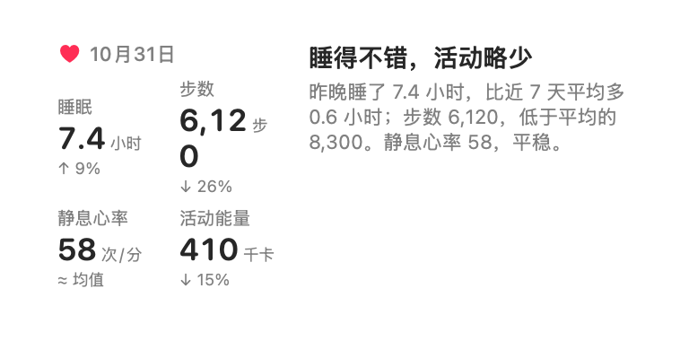
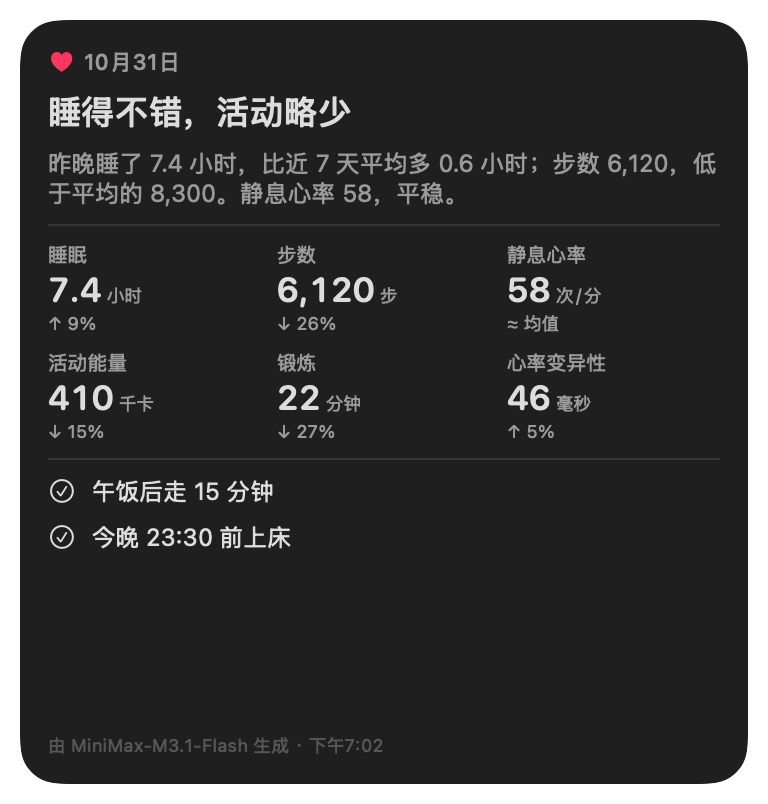

# HealthGlance

English | [中文](README.zh-CN.md)

A macOS desktop widget that reads your iPhone Health data once a day and shows a short AI-written summary: how you slept, how much you moved, how today compares with your last 7 days, and one or two things to do next.

<p>
  
  
</p>

*The screenshots use made-up sample data.* The app UI and the summaries are in Chinese. To get them in another language, edit the prompt in `Sources/App/Engine.swift`.

## How it works

macOS has no Health app, so a Mac cannot read Health data directly. An iPhone shortcut exports the numbers to iCloud Drive instead. A small menu-bar app on the Mac reads them, asks the MiniMax API for a summary, and the desktop widget shows the result.

```
iPhone shortcut ──writes──▶ iCloud Drive/Shortcuts/HealthWidget/health.txt
                                      │
Mac menu-bar app ◀──reads─────────────┘ ──calls──▶ MiniMax (OpenAI-compatible API)
        │ writes ~/Library/Application Support/HealthWidget/summary.json
        ▼
Desktop widget (small / medium / large), or a card pinned to the desktop
```

## Requirements

- A Mac with Apple Silicon, running macOS 14 Sonoma or later.
- Xcode Command Line Tools. Install them with `xcode-select --install`. The full Xcode is not needed.
- An iPhone with Health data. An Apple Watch is optional, but some metrics need one.
- A MiniMax API key from [platform.minimaxi.com](https://platform.minimaxi.com) (China) or [platform.minimax.io](https://platform.minimax.io) (international).

## Install on the Mac

```bash
git clone git@github.com:AlbertHX86/health-glance.git
cd health-glance
./build.sh install    # builds, signs locally, copies to ~/Applications and launches
```

1. Click the heart icon in the menu bar, paste your MiniMax API key and click **保存** (Save).
2. Right-click an empty part of the desktop, choose **Edit Widgets**, search for **健康小结** and drag it onto the desktop.
3. If the widget does not appear in the list, turn on **在桌面固定卡片** (pin card to desktop) in the menu instead. It shows the same card in a window that you can drag around.
4. To start the app at login, turn on **开机启动** (launch at login).

## Set up the iPhone shortcut (once)

**Step 1: Create the shortcut.** In the Shortcuts app, create a shortcut named `Health Export`. For each metric, add **Find Health Samples** with these filters, followed by the action in the last column:

| Metric | Find Health Samples filters | Then |
|---|---|---|
| Steps | Type is Steps; Start Date is today | Calculate Statistics: Sum |
| Sleep | Type is Sleep Analysis; End Date is today; Value is not Awake; Value is not In Bed | Get Details of Health Sample: Duration → Calculate Statistics: Sum |
| Resting heart rate | Type is Resting Heart Rate; sort by Start Date, Latest First; Limit 1 | nothing |
| Active energy | Type is Active Energy; Start Date is today | Calculate Statistics: Sum |
| Exercise (optional, needs Apple Watch) | Type is Exercise Minutes; Start Date is today | Calculate Statistics: Sum |
| HRV (optional) | Type is Heart Rate Variability; Start Date is today | Calculate Statistics: Average |
| Weight (optional) | Type is Weight; sort by Start Date, Latest First; Limit 1 | nothing |

Do not use **Start Date is in the last 1 day**. It also includes yesterday, so steps come out as yesterday plus today. **Is today** gives the same numbers as the Health app's "Today". For sleep, **End Date is today** picks last night.

**Step 2: Combine the results into text.** Add a **Text** action with one line per metric. After each colon, insert the result of the matching step from Step 1:

```
steps: [Statistics]
sleep: [Statistics]
resting heart rate: [Health Samples]
active energy: [Statistics]
```

Line names can be English or Chinese, for example `steps` or `步数`. Units are optional: `7 h 24 min`, `26640` (seconds) and `6.2 h` are all understood.

**Step 3: Save the file.** Add **Save File**. Turn off **Ask Where to Save**, set the subpath to `HealthWidget/health.txt` and turn on **Overwrite If File Exists**.

**Step 4: Run it once by hand.** The first time, the iPhone asks for permission to read each Health data type; allow them all. An automation cannot show these prompts, which is why the first run has to be manual.

**Step 5: Run it automatically.** In **Automation**, tap **+**, choose **App**, pick an app you open every morning, choose **Is Opened** and **Run Immediately**, then select `Health Export`.

An app trigger is used instead of a time of day because a locked iPhone cannot read Health data, so a timed run often fails.

Action names can differ slightly between iOS versions. If a filter is missing, skip it.

## When summaries are made

The Mac checks iCloud once a minute and writes a new summary when the numbers change. Automatic summaries are made at most once every 30 minutes. Each time the shortcut runs, the file is updated, so the summary follows your day. iCloud usually takes from a few seconds to a few minutes to bring a new file from the iPhone to the Mac.

To make a summary right away, click **立即生成** (generate now) in the menu.

## Configuration

Settings live in `~/Library/Application Support/HealthWidget/config.json`. The file has mode 600 and is never committed:

```json
{
  "apiKey": "<your MiniMax API key>",
  "baseURL": "https://api.minimaxi.com/v1",
  "model": "MiniMax-M3.1-Flash",
  "reasoningEffort": "low"
}
```

For the international platform, set `baseURL` to `https://api.minimax.io/v1`. Any OpenAI-compatible endpoint and model also work. The environment variable `MINIMAX_API_KEY` overrides the key in the file, which is useful for the command-line tool.

## Privacy

- To make the summary, the day's health numbers are sent to the MiniMax API. Do not use the app if you do not want that.
- Nothing else leaves the Mac. The last 30 days of numbers are stored in `history.json` next to the config file, and are used for the 7-day comparison.
- The widget runs in a sandbox. It can read only `summary.json`: it cannot read the config file with your key, and it has no network access.

## Testing without an iPhone

```bash
./build/healthwidget-cli sample/2026-10-31.txt               # parse only
./build/healthwidget-cli sample/2026-10-31.txt --generate    # also call MiniMax; prints, writes nothing
./build/healthwidget-cli --generate --save                   # newest data → summary.json, as the app does
```

Files dropped into `~/Library/Application Support/HealthWidget/inbox/` are read as well.

## Troubleshooting

| Symptom | Cause and fix |
|---|---|
| Steps or sleep far too high | The shortcut uses **in the last 1 day**, or sleep includes **In Bed**. Use the filters in the table above. |
| Numbers are higher than the Health app's | The iPhone and Apple Watch both recorded the same activity, and the shortcut adds them up. For sleep, add **Source is (your watch)**. |
| The widget is not in the widget list | Use **在桌面固定卡片** (pin card to desktop). |
| The menu says **还没有填 MiniMax API Key** | No key has been saved. Paste it in the menu and click **保存**. |
| The summary does not change | Check that `health.txt` updated in Files → iCloud Drive → Shortcuts → HealthWidget. |

## Project layout

| Path | Contents |
|---|---|
| `Sources/Shared/Health.swift` | File locations, parser, summary and history cache |
| `Sources/Shared/CardView.swift` | The card UI, shared by the widget and the pinned card |
| `Sources/App/Engine.swift` | MiniMax call and prompt |
| `Sources/App/App.swift` | Menu-bar app: watching for data, generating, pinned card, launch at login |
| `Sources/Widget/Widget.swift` | WidgetKit widget |
| `Sources/CLI/main.swift` | Command-line test tool |
| `build.sh` | Build, sign, install |

The summaries are written from the exported numbers only and are not medical advice.

## License

[MIT](LICENSE)
