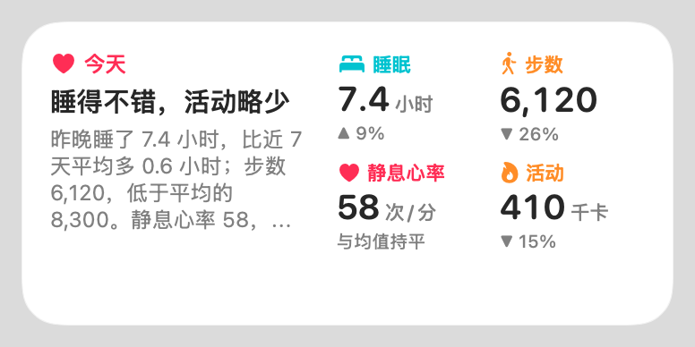
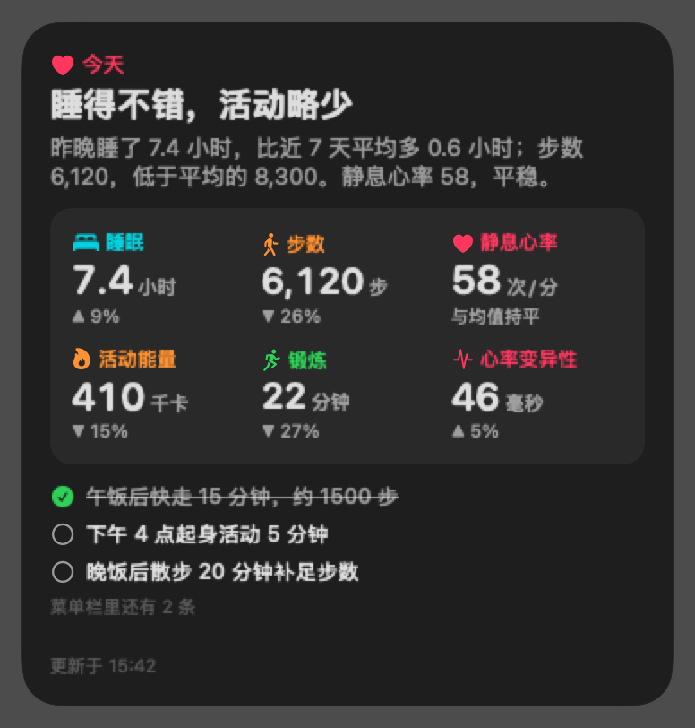
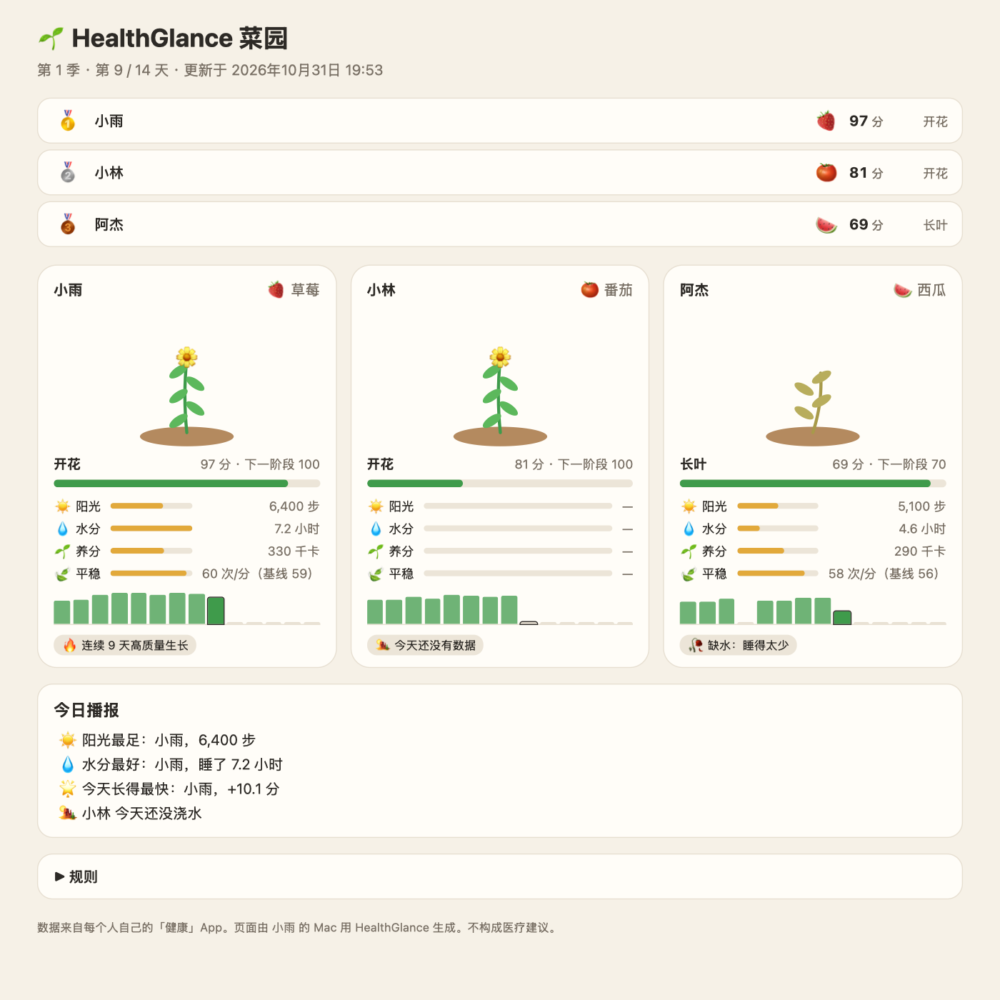

# HealthGlance 健康小结

[English](README.md) | 中文

Mac 桌面小组件。每天读取 iPhone「健康」App 的数据，用 AI 写一段简短的小结，显示在桌面上。小结会说明睡得怎么样、活动量多少、和过去 7 天比如何，再给一两条马上能做的建议。

<p>
  
  
</p>

*截图里是虚构的示例数据。*界面和小结支持英文和中文，默认英文，在菜单里的「Language」切换。

## 工作原理

macOS 没有「健康」App，Mac 不能直接读取健康数据。所以由 iPhone 的快捷指令把数字导出到 iCloud 云盘，Mac 上的菜单栏程序读取后调用 MiniMax 生成小结，再交给桌面小组件显示。

```
iPhone 快捷指令 ──写入──▶ iCloud 云盘/快捷指令/HealthWidget/health.txt
                                   │
Mac 菜单栏程序 ◀──读取──────────────┘ ──调用──▶ MiniMax（OpenAI 兼容接口）
        │ 写入 ~/Library/Application Support/HealthWidget/summary.json
        ▼
桌面小组件（小 / 中 / 大三种尺寸），或固定在桌面上的卡片
```

## 需要准备

- Apple 芯片的 Mac，系统 macOS 14 Sonoma 或更新版本。
- Xcode 命令行工具，用 `xcode-select --install` 安装。不需要完整的 Xcode。
- 有健康数据的 iPhone。Apple Watch 不是必须的，但有些指标要靠它记录。
- MiniMax API Key，在 [platform.minimaxi.com](https://platform.minimaxi.com)（国内站）或 [platform.minimax.io](https://platform.minimax.io)（国际站）申请。

## 在 Mac 上安装

```bash
git clone git@github.com:AlbertHX86/health-glance.git
cd health-glance
./build.sh install    # 编译、本地签名，安装到 ~/Applications 并启动
```

1. 点菜单栏的心形图标，把「Language」切到「中文」。填入 MiniMax API Key，点「保存」。
2. 在桌面空白处右键，选「编辑小组件」，搜索「HealthGlance」，拖到桌面上。有小、中、大三种尺寸。
3. 如果小组件列表里找不到，就在菜单里打开「在桌面固定卡片」。它会用一个可拖动的窗口显示同样的卡片。
4. 想开机自动运行，打开「开机启动」。

## 设置 iPhone 快捷指令（只需一次）

快捷指令可以让 iPhone 根据文字描述自动生成，也可以手动搭建。两种方法做完后，都要接着做第 4、5 步。

### 快速方法：用文字描述，让 iPhone 自动生成

iOS 27 搭配 Apple Intelligence 时，「快捷指令」App 可以根据一段文字描述自动生成快捷指令。在「快捷指令」App 里点「+」，粘贴下面这段话：

```text
创建一个名为「健康导出」的快捷指令，按顺序执行以下步骤：
1. 查找健康样本，条件：类型是步数，开始日期是今天。然后计算统计数据：总和。
2. 查找健康样本，条件：类型是睡眠分析，结束日期是今天，值不是清醒，值不是在床上。然后获取健康样本的详细信息：时长。然后计算统计数据：总和。
3. 查找健康样本，条件：类型是静息心率，按开始日期排序，最新的在前，限制为 1 个。
4. 查找健康样本，条件：类型是活动能量，开始日期是今天。然后计算统计数据：总和。
5. 添加一个文本，内容只有下面四行，每行冒号后面放对应步骤的结果：
步数: 第 1 步的结果
睡眠: 第 2 步的结果
静息心率: 第 3 步的结果
活动能量: 第 4 步的结果
6. 存储文件：把这段文本存到 iCloud 云盘的「快捷指令」文件夹，子路径为 HealthWidget/health.txt。不要询问存储位置。文件已存在时覆盖。
所有日期条件都不要用「在最近 1 天」。
```

自动生成的结果不一定完全正确。保存前，请和下面的第 1–3 步逐项对照，特别注意日期条件。如果 iPhone 的系统语言是英文，就用 [README.md](README.md) 里的英文描述。生成好之后，接着做第 4 步。

### 手动搭建

**第 1 步：新建快捷指令。**在「快捷指令」App 里新建一个快捷指令，命名为「健康导出」。每项指标先加一个「查找健康样本」，按表中条件设置，再加最后一列的动作：

| 指标 | 「查找健康样本」的条件 | 之后的动作 |
|---|---|---|
| 步数 | 类型 是 步数；开始日期 是今天 | 计算统计数据：总和 |
| 睡眠 | 类型 是 睡眠分析；结束日期 是今天；值 不是 清醒；值 不是 在床上 | 获取健康样本的详细信息：时长 → 计算统计数据：总和 |
| 静息心率 | 类型 是 静息心率；按开始日期排序，最新的在前；限制 1 | 不需要 |
| 活动能量 | 类型 是 活动能量；开始日期 是今天 | 计算统计数据：总和 |
| 锻炼（可选，需要 Apple Watch） | 类型 是 锻炼分钟数；开始日期 是今天 | 计算统计数据：总和 |
| 心率变异性（可选） | 类型 是 心率变异性；开始日期 是今天 | 计算统计数据：平均值 |
| 体重（可选） | 类型 是 体重；按开始日期排序，最新的在前；限制 1 | 不需要 |

不要用「开始日期 在最近 1 天」。它会把昨天也算进去，步数就成了昨天加今天的总和。用「是今天」，数字才和健康 App 里的「今天」一致。睡眠用「结束日期 是今天」，取的是昨晚。

**第 2 步：拼成文本。**加一个「文本」动作，每项指标写一行。冒号后面插入第 1 步里对应那一步的结果：

```
步数: [统计数据]
睡眠: [统计数据]
静息心率: [健康样本]
活动能量: [统计数据]
```

行名可以用中文或英文，例如「步数」或「steps」。单位可写可不写，「7 小时 24 分钟」「26640」（秒）「6.2 h」都能识别。

**第 3 步：存储文件。**加一个「存储文件」动作。关闭「询问存储位置」，子路径填 `HealthWidget/health.txt`，打开「覆盖原有文件」。

### 收尾（两种方法都要做）

**第 4 步：先手动运行一次。**第一次运行时，iPhone 会逐项询问能否读取健康数据，全部允许。自动化运行时弹不出这些询问，所以第一次必须手动运行。

**第 5 步：设为自动运行。**打开「自动化」，点「+」，选「App」，选一个你每天早上都会打开的 App（例如微信）。再选「已打开」和「立即运行」，然后选「健康导出」。

用打开 App 触发、不用定时触发，是因为 iPhone 锁屏时读不到健康数据，定时运行常会失败。

不同 iOS 版本的动作名称可能略有差别，找不到某个条件就跳过。

## 显示别人的数据

Mac 端可以显示多个人。每个人一个文件，命名为 `health-<名字>.txt`，例如 `health-妈妈.txt`。每个人有各自的小结和 7 天历史。在菜单里用「显示」选择显示谁，小组件和桌面卡片会跟着切换。

对方的健康数字同样会被发送给 MiniMax，设置之前请先征得对方同意。

**第 1 步：测试 iPhone 能否读到对方共享的数据。**别人在「健康」App 的「共享」里分享给你的数据，快捷指令不一定读得到。要确认的话，把下面这段描述粘贴到「快捷指令」App（iOS 27）生成一个测试快捷指令，然后运行一次：

```text
创建一个名为「健康来源测试」的快捷指令，按顺序执行以下步骤：
1. 查找健康样本，条件：类型是步数，开始日期在最近 7 天。按开始日期排序，最新的在前，限制为 500 个。
2. 获取第 1 步健康样本的详细信息：来源。
3. 查找健康样本，条件：类型是心率，开始日期在最近 7 天。按开始日期排序，最新的在前，限制为 500 个。
4. 获取第 3 步健康样本的详细信息：来源。
5. 添加一个文本，内容是第 2 步的结果，换行，再接第 4 步的结果，每个来源占一行。
6. 存储文件：把这段文本存到 iCloud 云盘的「快捷指令」文件夹，子路径为 HealthWidget/sources.txt。不要询问存储位置。文件已存在时覆盖。
```

一分钟内，Mac 菜单里会出现「来源测试」，列出写入这些数据的每台设备和每个 App，以及各自的样本数。

**第 2 步：设置对方的文件。**根据测试结果分两种情况：

- **列表里有对方的设备：**说明你的 iPhone 能读到对方的数据。复制一份「健康导出」，在每个「查找健康样本」里加上条件「来源 是 对方的设备」，再把「存储文件」的文件名改成 `HealthWidget/health-<名字>.txt`。
- **列表里只有你自己的设备：**说明读不到对方共享的数据，需要由对方在自己的 iPhone 上导出：
  1. 在你的 iPhone 或 Mac 上，在 iCloud 云盘里新建一个名为 `HealthGlance` 的文件夹，共享给对方，权限设为「可以更改」。
  2. 对方在自己的 iPhone 上，按上面的步骤建好「健康导出」。
  3. 对方在「存储文件」里选择这个共享的 `HealthGlance` 文件夹，文件名用 `health-<名字>.txt`。
  4. Mac 端也会读取这个文件夹。

## 菜园 PK

共享 `HealthGlance` 文件夹的每个人各种一株植物，每天的健康数据会让它长大。由一台 Mac 把菜园页面写进共享文件夹，大家都能在访达里打开，或者在 iPhone 的「文件」App 里打开。



*图中是虚构的玩家。*

### 机制

1. **玩家：**共享文件夹里的每个 `health-名字.txt` 就是一位玩家。负责生成页面的 Mac（主持人）会把自己的数据也加进来，名字在菜单里设置。
2. **选植物：**玩家在自己的文件里加一行，例如「植物: 番茄」或「plant: tomato」。主持人在菜单里选。每一季以第一次写的植物为准，中途换不了。
3. **页面：**主持人在菜单里打开「菜园 › 由这台 Mac 生成菜园页面」。只有某人的数字变了，页面才会重写。
4. **不用 AI：**菜园完全按固定公式计算，不会把任何人的数据发给 MiniMax。

**规则**

| 要素 | 来源 | 满分条件 |
|---|---|---|
| ☀️ 阳光 | 步数 | 1 万步 |
| 💧 水分 | 睡眠 | 7–9 小时；过少或过多都减分 |
| 🌱 养分 | 活动能量或锻炼，取较高的一项 | 500 千卡或 30 分钟 |
| 🍃 平稳 | 静息心率，和自己前 7 天的平均比 | 不高于自己的平均 |

每项要素 0 到 1 分。每日生长 = 10 × 按植物权重加权的四项要素，每天最多 10 分。

- **测不到的要素：**按 0.5 计，没有 Apple Watch 也不吃亏。
- **没有数据的那天：**不生长。
- **连胜加成：**连续 3 天以上每天至少 7 分，每天额外加 1 分。
- **公平性：**心率只和自己的基线比，不和别人比。

| 植物 | ☀️ | 💧 | 🌱 | 🍃 | 特点 |
|---|---|---|---|---|---|
| 🍅 番茄 | 45% | 20% | 20% | 15% | 步数最重要 |
| 🍉 西瓜 | 15% | 50% | 15% | 20% | 睡眠最重要 |
| 🌻 向日葵 | 30% | 15% | 45% | 10% | 活动能量和锻炼最重要 |
| 🥕 胡萝卜 | 15% | 25% | 15% | 45% | 心率平稳最重要 |
| 🍓 草莓 | 25% | 25% | 25% | 25% | 均衡；连胜加成翻倍 |
| 🎃 南瓜 | 25% | 30% | 25% | 20% | 前 7 天生长 ×0.8，之后 ×1.3 |

阶段：种子 0 → 发芽 8 → 幼苗 25 → 长叶 45 → 开花 70 → 结果 100 → 丰收 130 分。每季 14 天，每天都表现不错的话，季末能长到「结果」。季末分数最高的人获胜。

### 每位玩家的设置

1. 主持人在 iCloud 云盘里新建一个 `HealthGlance` 文件夹，共享给每位玩家，权限设为「可以更改」。
2. 每位玩家在自己的 iPhone 上，把下面这段描述粘贴到「快捷指令」App（iOS 27），并把名字和植物换成自己的：

```text
创建一个名为「菜园导出」的快捷指令，按顺序执行以下步骤：
1. 查找健康样本，条件：类型是步数，开始日期是今天。然后计算统计数据：总和。
2. 查找健康样本，条件：类型是睡眠分析，结束日期是今天，值不是清醒，值不是在床上。然后获取健康样本的详细信息：时长。然后计算统计数据：总和。
3. 查找健康样本，条件：类型是静息心率，按开始日期排序，最新的在前，限制为 1 个。
4. 查找健康样本，条件：类型是活动能量，开始日期是今天。然后计算统计数据：总和。
5. 添加一个文本，内容只有下面五行，后四行的冒号后面放对应步骤的结果：
植物: 番茄
步数: 第 1 步的结果
睡眠: 第 2 步的结果
静息心率: 第 3 步的结果
活动能量: 第 4 步的结果
6. 存储文件：把这段文本存到 iCloud 云盘里共享的「HealthGlance」文件夹，文件名为 health-名字.txt。不要询问存储位置。文件已存在时覆盖。
所有日期条件都不要用「在最近 1 天」。
```

如果生成的「存储文件」没有指向共享文件夹，就点它的文件夹，手动选 `HealthGlance`。之后每位玩家先手动运行一次，再按上面第 5 步设置每天打开 App 时自动运行。

### 注意

- **只能有一个主持人：**只能由一台 Mac 生成页面。两台 Mac 同时改共享文件夹里的同一个文件，iCloud 会留下冲突的副本。
- **语言：**页面使用主持人的语言设置。
- **日期：**「每一天」按主持人所在的时区划分。
- **隐私：**共享文件夹里的每个人都能看到所有人每天的数字。

`config.json` 里的菜园设置：

| 设置 | 含义 |
|---|---|
| `gardenHost` | 这台 Mac 是否生成页面 |
| `gardenName` | 你在页面上的名字 |
| `gardenPlant` | 你的植物 |
| `gardenDays` | 每季天数，默认 14 |
| `gardenStart` | 第 1 季的第一天，格式 `yyyy-MM-dd`；默认是最早有人有数据的那天 |

## 什么时候生成小结

Mac 每分钟检查一次 iCloud 里的文件，数字一变就重新生成小结，自动生成最多每 30 分钟一次。快捷指令每运行一次，文件就更新一次，所以小结会跟着你的一天更新。iCloud 把手机上的新文件同步到 Mac，通常要几秒到几分钟。

想马上生成，点菜单里的「立即生成」。

## 配置

设置保存在 `~/Library/Application Support/HealthWidget/config.json`。文件权限为 600，不会提交到仓库：

```json
{
  "apiKey": "<你的 MiniMax API Key>",
  "baseURL": "https://api.minimaxi.com/v1",
  "model": "MiniMax-M3.1-Flash",
  "reasoningEffort": "low",
  "language": "zh"
}
```

`language` 为 `en` 或 `zh`，菜单里的「Language」切换的就是它。用国际站时，把 `baseURL` 改成 `https://api.minimax.io/v1`。其他兼容 OpenAI 的接口和模型也可以用。环境变量 `MINIMAX_API_KEY` 会覆盖文件里的 Key，用命令行工具测试时方便。

## 隐私

- 生成小结时，当天的健康数字会发送给 MiniMax 接口。如果不希望这样，请不要使用本程序。
- 你添加的其他人的数据也一样会被发送（见「显示别人的数据」），请先征得对方同意。
- 除此之外，数据不会离开 Mac。最近 30 天的数字保存在配置文件旁边的 `history.json` 里，用于和 7 天平均对比。
- 小组件运行在沙盒里，只能读取 `summary.json`。它读不到存有 Key 的配置文件，也不能联网。

## 不用 iPhone 测试

```bash
./build/healthwidget-cli sample/2026-10-31.txt               # 只解析
./build/healthwidget-cli sample/2026-10-31.txt --generate    # 同时调用 MiniMax；只打印，不写文件
./build/healthwidget-cli --generate --save                   # 读最新数据，写入 summary.json，与程序相同
./build/healthwidget-cli --sources                           # 查看来源测试的结果
./build/healthwidget-cli --garden                            # 立即更新菜园页面
./build/healthwidget-cli --garden-demo --lang zh             # 用虚构玩家生成 build/garden-demo.html
```

放进 `~/Library/Application Support/HealthWidget/inbox/` 的文件也会被读取。

## 常见问题

| 现象 | 原因和解决办法 |
|---|---|
| 步数或睡眠明显偏高 | 快捷指令用了「在最近 1 天」，或者睡眠把「在床上」也算进去了。按上面表格里的条件设置。 |
| 数字比健康 App 里的高 | iPhone 和 Apple Watch 记录了同一段活动，快捷指令把两边加在了一起。睡眠可以加一个条件「来源 是 你的手表」。 |
| 小组件列表里找不到 | 用「在桌面固定卡片」。 |
| 菜单显示「还没有填 MiniMax API Key」 | 还没保存 Key。在菜单里粘贴后点「保存」。 |
| 小结一直不变 | 打开「文件」App，在 iCloud 云盘 › 快捷指令 › HealthWidget 里看 health.txt 有没有更新。 |

## 文件结构

| 路径 | 内容 |
|---|---|
| `Sources/Shared/Health.swift` | 文件位置、数据解析、小结和历史缓存 |
| `Sources/Shared/CardView.swift` | 卡片界面，小组件和桌面卡片共用 |
| `Sources/App/Engine.swift` | MiniMax 调用与提示词（英文、中文各一份） |
| `Sources/App/App.swift` | 菜单栏程序：监视数据、生成小结、桌面卡片、开机启动 |
| `Sources/App/Garden.swift` | 菜园 PK：规则、记录、页面 |
| `Sources/Widget/Widget.swift` | WidgetKit 小组件 |
| `Sources/CLI/main.swift` | 命令行测试工具 |
| `build.sh` | 编译、签名、安装 |

小结只依据导出的数字生成，不构成医疗建议。

## 许可证

[MIT](LICENSE)
